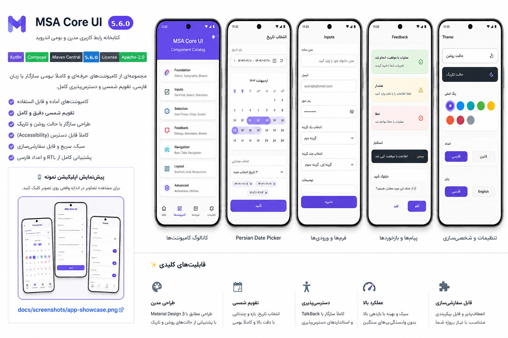

# MSA Core UI

A modular, production-oriented **Android Jetpack Compose design system** with accessible Material 3 components and a Persian/Solar Hijri calendar.

این پروژه یک Core UI واقعی و Android-only است؛ منطق تقویم از UI جدا شده، ماژول‌های عمومی مستقل منتشر می‌شوند، Catalog و دو نوع Consumer verification دارد، و Build/Release gateهای آن در CI تعریف شده‌اند.

> Current status: **statically hardened; Android build and runtime verification are still required.**

## App showcase / نمای اپلیکیشن

<p align="center">
  <a href="docs/screenshots/app-showcase.png">
    
  </a>
</p>

<p align="center"><sub>Design-aligned mockup (not a runtime screenshot) — ماکاپ طراحی، نه اسکرین‌شات اجرای واقعی. برای اندازه‌ی کامل روی تصویر کلیک کنید.</sub></p>

The `catalog` module implements the same visual structure shown above: purple gradient identity, card categories, production forms, feedback states, inline Persian calendar, adaptive navigation, and persisted theme/language settings.

## Modules

| Module | Maven artifact | Purpose |
|---|---|---|
| `core-ui-foundation` | `com.msa.coreui:core-ui-foundation` | Theme, semantic colors, typography, shapes, spacing, elevation, sizing, motion, breakpoints and adaptive content layout |
| `core-ui-components` | `com.msa.coreui:core-ui-components` | Buttons, icon buttons, fields, surfaces, list rows, chips, selection controls, feedback, progress, dialogs, loading and state views |
| `core-ui-calendar-core` | `com.msa.coreui:core-ui-calendar-core` | Pure JVM Solar Hijri conversion, parsing, formatting, validation and date arithmetic |
| `core-ui-calendar` | `com.msa.coreui:core-ui-calendar` | Material 3 Persian date picker with single, range and multiple selection |
| `core-ui` | `com.msa.coreui:core-ui` | Aggregate artifact that re-exports every public module |
| `catalog` | — | Showcase-matched Persian-first app with card navigation, forms, feedback, inline calendar, live theme colors, dark mode, digits and RTL/LTR controls |
| `consumer-smoke` | — | Compile consumer using only the aggregate project dependency |
| `maven-consumer` | — | Compile consumer resolving generated Maven coordinates and transitive POM metadata |

## Baseline

```text
Android: API 26+
compileSdk / targetSdk: 36
JDK / JVM target: 17
Gradle: 8.13
Android Gradle Plugin: 8.13.2
Kotlin: 2.3.21
Compose BOM: 2026.06.00
Material: Material 3 only
```

The project intentionally stays on AGP 8.13.2 instead of performing an unverified AGP 9 migration. See [DEPENDENCY_UPGRADE_REPORT.md](DEPENDENCY_UPGRADE_REPORT.md).

## Installation

Generate a local Maven repository:

```bash
./gradlew publishAllPublicationsToBuildRepositoryRepository
```

The repository is written to `build/repository`.

```kotlin
repositories {
    maven { url = uri("../MSA-Core-UI/build/repository") }
    google()
    mavenCentral()
}

dependencies {
    implementation("com.msa.coreui:core-ui:5.7.0-SNAPSHOT")
}
```

Smaller dependency surfaces:

```kotlin
implementation("com.msa.coreui:core-ui-foundation:5.7.0-SNAPSHOT")
implementation("com.msa.coreui:core-ui-components:5.7.0-SNAPSHOT")
implementation("com.msa.coreui:core-ui-calendar-core:5.7.0-SNAPSHOT")
implementation("com.msa.coreui:core-ui-calendar:5.7.0-SNAPSHOT")
```

## Theme and adaptive layout

```kotlin
CoreUiTheme(
    darkTheme = isSystemInDarkTheme(),
    dynamicColor = false,
    motion = CoreUiMotion(animationsEnabled = userAllowsMotion),
    strings = if (isPersian) CoreUiStrings.Persian else CoreUiStrings.English,
) {
    CoreContentContainer {
        AppContent()
    }
}
```

Available token families:

```kotlin
CoreUiTheme.spacing
CoreUiTheme.radii
CoreUiTheme.elevation
CoreUiTheme.alpha
CoreUiTheme.stroke
CoreUiTheme.motion
CoreUiTheme.sizing
CoreUiTheme.breakpoints
CoreUiTheme.statusColors
CoreUiTheme.strings
```

## Components

```kotlin
CoreButton(
    content = CoreButtonContent("Continue"),
    onClick = ::continueFlow,
)

CoreTextField(
    value = email,
    onValueChange = { email = it },
    label = "Email",
    status = CoreFieldStatus.SUCCESS,
    supportingText = "Verified",
)

CoreChip(
    label = "Active",
    selected = true,
    onClick = ::toggleFilter,
)

CoreSwitchRow(
    title = "Notifications",
    checked = notificationsEnabled,
    onCheckedChange = ::setNotificationsEnabled,
)

CoreLinearProgress(
    progress = uploadProgress,
    contentDescription = "Upload progress",
)
```

## Persian/Solar Hijri calendar core

The core artifact has no Android or Compose dependency:

```kotlin
val persian = PersianCalendar.fromGregorian(LocalDate.of(2024, 3, 20))
check(persian == PersianDate(1403, 1, 1))
check(LocalDate.of(560, 3, 20) == PersianCalendar.MIN_SUPPORTED_GREGORIAN_DATE)
check(LocalDate.of(3798, 3, 19) == PersianCalendar.MAX_SUPPORTED_GREGORIAN_DATE)

val parsed = PersianDateFormatter.parseIso("۱۴۰۳-۰۱-۰۹")
val nextMonth = parsed.plusMonths(1)
val iso = PersianDateFormatter.iso(nextMonth)
```

`LocalDate` is the recommended storage/API type. `PersianDate` owns Solar Hijri validation, presentation and arithmetic. Conversion itself is timezone-independent; `Clock` is used only for resolving “today”.

## Date picker

```kotlin
val state = rememberPersianDatePickerState(
    selectionMode = PersianDateSelectionMode.RANGE,
    config = PersianDatePickerConfig(
        minDate = LocalDate.of(2020, 1, 1),
        maxDate = LocalDate.of(2035, 12, 31),
        disabledDates = holidays,
        firstDayOfWeek = DayOfWeek.SATURDAY,
        allowDisabledDatesInsideRange = false,
    ),
)

PersianDatePickerDialog(
    state = state,
    onDismissRequest = { showPicker = false },
    dimensions = PersianDatePickerDimensions(
        monthCellMinWidth = 112.dp,
        yearCellMinWidth = 84.dp,
    ),
    onConfirm = { selection ->
        saveSelection(selection)
        showPicker = false
    },
)
```


Localized selection text for product UI:

```kotlin
val label = PersianDateSelectionFormatter.format(
    selection = state.selection,
    strings = PersianDatePickerStrings.Persian,
    usePersianDigits = true,
    emptyText = "تاریخی انتخاب نشده است",
)
```

Capabilities:

- Single, range and multiple selection
- Configurable Gregorian boundaries and disabled dates
- Configurable first day of week
- Optional adjacent-month days and navigation
- Persian or Latin digits
- Persian and English string sets
- Hoisted state and `rememberSaveable`
- RTL-safe layout
- Selected, range, disabled, today and indicator semantics
- Injected `Clock`
- Reduced-motion rendering
- Adaptive month/year grids and customizable picker dimensions
- Defensively copied localization collections and centralized Core UI fallback strings

## Verification commands

Checks that do not require an Android SDK or Gradle dependency resolution:

```bash
./scripts/static-audit.sh
./scripts/verify-distribution.sh
./scripts/verify-calendar-standalone.sh
```

Full Android/Gradle verification:

```bash
./gradlew \
  :core-ui-calendar-core:test \
  :core-ui-calendar:testDebugUnitTest \
  :core-ui-foundation:lintRelease \
  :core-ui-components:lintRelease \
  :core-ui-calendar:lintRelease \
  :core-ui:lintRelease \
  :consumer-smoke:assembleDebug \
  :catalog:assembleDebug \
  :catalog:assembleRelease \
  :dokkaGenerate

./gradlew --stacktrace releaseCandidateCheck
./gradlew :core-ui-components:connectedDebugAndroidTest :core-ui-calendar:connectedDebugAndroidTest
```

See [VERIFICATION.md](VERIFICATION.md) for the exact checks executed in the delivery environment.

## Documentation

- [Setup](SETUP.md)
- [Architecture](docs/ARCHITECTURE.md)
- [Design system](docs/DESIGN_SYSTEM.md)
- [Accessibility](docs/ACCESSIBILITY.md)
- [Calendar data contract](docs/CALENDAR_DATA_CONTRACT.md)
- [Testing](docs/TESTING.md)
- [Public API overview](API.md)
- [Public API compatibility](docs/API_COMPATIBILITY.md)
- [Dependency upgrade report](DEPENDENCY_UPGRADE_REPORT.md)
- [Deep transformation report](DEEP_TRANSFORMATION_REPORT.md)
- [گزارش بهبود عمیق فارسی](DEEP_IMPROVEMENT_REPORT_FA.md)
- [Rollback strategy](docs/ROLLBACK.md)
- [Migration](MIGRATION.md)
- [Release checklist](RELEASE_CHECKLIST.md)
- [Privacy](PRIVACY.md)
- [Third-party notices](THIRD_PARTY_NOTICES.md)

## License

Apache License 2.0. The calendar conversion engine contains MIT-licensed adapted work documented in `THIRD_PARTY_NOTICES.md`.

## Author

Developed and maintained by<br>
[ALISCHILLER](https://github.com/ALISCHILLER) — **MSA**

Email: [solimaniali90@gmail.com](mailto:solimaniali90@gmail.com)

## Product and release control

- Product requirements: [`PRD.md`](PRD.md)
- Requirement traceability: [`docs/REQUIREMENTS_TRACEABILITY.md`](docs/REQUIREMENTS_TRACEABILITY.md)
- Machine-readable release decision: [`release/release-gates.json`](release/release-gates.json)
- Release manifest: [`release/release-manifest.json`](release/release-manifest.json)

